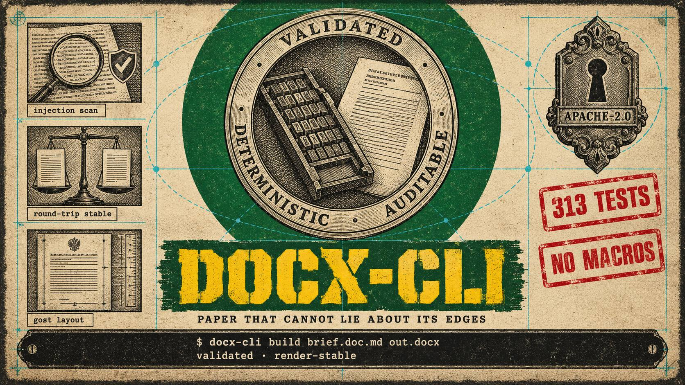

# docx-cli

    


<p align="center"></p>

Deterministic generator of Russian-language legal `.docx` documents. Builds from a
machine-checkable JSON spec (or Markdown for procedural filings), then re-opens the written
file and validates layout against the standard — margins, font, spacing, indents, list
numbering, dashes, «ё». Any mismatch is fail-closed: the partial file is removed and an
error envelope is returned. Includes an injection scanner for incoming text and an MCP mode.

[ Русский](README.ru.md) · **English**

## Install

```bash
pip install docx-cli
docx-cli doctor
```

From the repo: `pip install git+https://github.com/lnfnt/docx-cli.git`.

From PyPI: `pip install docx-cli`. Checkout: `git clone https://github.com/lnfnt/docx-cli.git && cd docx-cli
&& python3 -m venv .venv && . .venv/bin/activate && pip install -e .` (or `pipx install .`).
Python >= 3.11; deps: python-docx, pydantic, lxml. No network calls.

## Quickstart

```bash
docx-cli build examples/spec_example.json output.docx
docx-cli validate output.docx
docx-cli doctor
```

One JSON envelope per command; exit codes: 0 ok, 1 business rejection, 2 usage/structural
error (incl. strict warnings).

## Layout standard

| Setting | gost (default) | court profile |
|---|---|---|
| Page/margins | A4; L 3.0 / R 1.5 / T 2.0 / B 2.0 cm | same geometry |
| Font | Times New Roman 12 pt (headings 14) | Times New Roman 14 pt |
| Spacing | 1.5 (header/title 1.15) | 1.0 |
| Indents | 1.25 cm first line; body justified | header `left_indent = 7.0 cm`, hanging lists |

`vs_sud` (Supreme Court) and `soyu_rayon` (first-instance SOYU incl. justice-of-the-peace
slot) are formatting skeletons: geometry plus `{...}` placeholders, no normative content;
templates in `templates/vs_sud.json`, `templates/soyu_rayon.json`. Full contract: `SPEC.md`.

## MCP mode

```bash
docx-cli mcp            # JSON-RPC 2.0 on stdin/stdout
docx-cli mcp --tools    # tools/list dump
```

Eight tools: `docx_build`, `docx_validate`, `docx_scan`, `docx_normalize`, `docx_md_build`,
`docx_doctor`, `docx_agent_read`, `docx_verify_forbidden`. Write tools require `confirm:
true`; otherwise `status=needs_confirmation` and nothing is written. Malformed transport
lines return a `-32700` envelope without crashing.

## md-converter

Nested lists of depth 1-4 (`List Bullet/Number 2-3`; depth >4 skipped with a
`list_depth_gt4` marker in the report); GFM pipe tables (`Table Grid`, alignments, repeated
headers, inline formatting in cells, `\|` escaping); block constructs inside cells are
unsupported and flagged (`block_in_cell`). The md converter output is layout-stable across releases.

## Limits

- Not legal advice; does not validate case facts.
- Generation from spec/Markdown only — not an editor for foreign legacy .docx files.
- vs_sud/soyu_rayon carry formatting, not norms; normative content comes from your spec.

## License

Apache-2.0 (`LICENSE`). Verify: `sha256sum -c SHA256SUMS`, `gpg --verify *.asc` (key attached).

Author and copyright holder: [lnfnt](mailto:lnfnt@proton.me).
